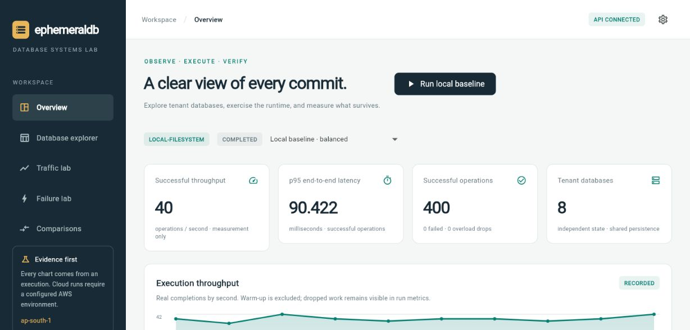

# EphemeralDB Benchmark

## Experiment Console

The project now includes a **Flutter Web experiment console**, a Python control API,
isolated rate-controlled jobs, database/transaction inspection, local failure proofs,
matched-run comparisons and raw evidence export. It also includes fenced S3 runtime
integration, a PostgreSQL/Aurora adapter, and Terraform/EKS deployment definitions.

```powershell
python -m pip install -e '.[console,dev]'
./scripts/start-console.ps1
```

Open **http://127.0.0.1:8765**. Local runs execute the real tenant engine without AWS.
See [console setup and operational contracts](docs/console.md) and
[implementation/validation status](docs/implementation-progress.md).
AWS deployment and fault experiments require configured resources and a valid session;
the presence of an adapter or deployment template does not establish live AWS evidence.



Phase 8 adds an opt-in fresh-namespace fenced ownership mode. Its authoritative commit is a
per-tenant control-object CAS, not WAL payload persistence. It includes collision-safe single
and shared-batch candidates, explicit takeover, conservative read admission, and recovery
after an unsealed process kill plus complete local-cache loss. See
[`docs/ownership-fencing.md`](docs/ownership-fencing.md) and
[`docs/phase-8-report.md`](docs/phase-8-report.md).

EphemeralDB Benchmark is an experimental infrastructure/database benchmark project. It will compare two real architecture paths under the same logical schema, synthetic workloads, benchmark harness, and reporting conventions:

- A Turso-inspired architecture with disposable Kubernetes compute, local NVMe cache, remotely durable WAL, WAL batching, checkpoints, and tenant database recovery.
- Amazon Aurora PostgreSQL Serverless v2 as the managed relational baseline.

## Project Goal

The project asks whether a database-per-tenant architecture with ephemeral compute and remotely durable WAL can deliver useful concurrency, recovery behavior, operational simplicity, and cost characteristics compared with Aurora PostgreSQL Serverless v2.

The Turso-inspired path is expected to use database compute pods on Amazon EKS, EC2 Spot workers with local NVMe, Amazon S3 Express One Zone for WAL durability, and Amazon S3 Standard for checkpoint storage. Aurora represents the practical managed relational architecture and must not be intentionally handicapped.

## Core Research Questions

- How much write concurrency is possible when ownership is coordinated per tenant database?
- What latency cost is introduced by remote WAL durability and WAL batching?
- How large can WAL batches become under different tenant-density and workload distributions?
- How often should checkpoints occur to balance recovery time, storage cost, and write overhead?
- What happens to acknowledged transactions after process, pod, and worker-node failures?
- How quickly can a tenant database recover on a new pod after losing all local cache state?
- How do autoscaling and tenant density affect throughput, p95 latency, and p99 latency?
- What are the cost tradeoffs per benchmark run and per million transactions?

## Current Status

Core Phases 0–8 and the console extension are implemented. Phase 7 added
consistent full-database checkpoints, immutable S3 Standard publication,
and bounded checkpoint-to-WAL recovery with a real process-kill/cache-loss proof.
See [the Phase 7 report](docs/phase-7-report.md), [checkpoint contracts](docs/checkpointing.md),
and [recovery demo](docs/recovery-demo.md). Phase 6 stabilization remains the
admission/retry foundation; its [report](docs/phase-6-stabilization-report.md) is historical.

The repository includes the Phase 0 architecture foundation, deterministic schema
and workloads, the tenant SQLite engine, explicit logical WAL, S3 Express storage,
cross-tenant batching, stabilization, and Phase 7 checkpoint/recovery tooling.

The local engine resolves tenant DBs from a manifest, caches thread-aware SQLite
connections with an idle eviction target, executes reads/writes, returns structured
results, and validates logical state. Explicit WAL supports local development,
S3 single-record persistence, and cross-tenant batches. Retained-state restart
verification and reconciliation assume exclusive single-runtime ownership.

The console extension adds a PostgreSQL/Aurora adapter, Docker packaging, Terraform/EKS
definitions, fixed tenant routing, and recovery after a runtime restart. Phase 8 fenced
namespaces support unsealed recovery; legacy payload-only namespaces retain their
exclusive-writer/sealed-boundary contracts. Live AWS deployment, automatic elastic
placement and broader infrastructure failure validation remain outstanding.

## Cache-Loss Proof

```bash
python -m ephemeraldb.recovery.demo --mode batch
python -m ephemeraldb.recovery.demo --mode single --scenario durable-before-ack
```

The offline proof kills a child process, removes its complete cache, restores two
tenants from checkpoints at sequence 2 plus WAL through 4, checks independent
logical-state equality and retry identity, then writes sequence 5. It preserves
versioned evidence and external test stores under `benchmark/results/recovery/`.
This is filesystem-adapter correctness evidence, not AWS performance evidence.

## Dataset Generation

Generate a small deterministic tenant-local SQLite dataset:

```bash
python -m ephemeraldb.schema.generator --output-dir ./generated --tenants 3 --entities-per-tenant 100 --seed 42
```

Validate a generated dataset directory:

```bash
python -m ephemeraldb.schema.validation --dataset-dir ./generated
```

The generated `manifest.json` and logical database checksums are deterministic for the same configuration and seed.

## Workload Generation

Generate a deterministic workload from a dataset manifest:

```bash
python -m ephemeraldb.loadgen.generator --dataset-manifest ./generated/manifest.json --profile hot-contention --schedule small-dev --seed 42 --output ./benchmark/workloads/hot-contention.jsonl
```

Validate the workload artifact:

```bash
python -m ephemeraldb.loadgen.validation ./benchmark/workloads/hot-contention.jsonl
```

Inspect workload-definition statistics:

```bash
python -m ephemeraldb.loadgen.stats ./benchmark/workloads/hot-contention.jsonl
```

This is not a traffic runner. It creates replayable operation intent that future backend adapters can execute against both architecture paths.

## Local Engine Run

Run a workload sequentially against generated local tenant SQLite databases:

```bash
python -m ephemeraldb.engine.runner --dataset-dir ./generated --workload ./benchmark/workloads/hot-contention.jsonl --output ./benchmark/results/local-hot-contention.jsonl
```

SQLite's internal WAL mode is a local engine setting and is not the explicit EphemeralDB WAL.

Optionally emit local development WAL records while running a workload:

```bash
python -m ephemeraldb.engine.runner --dataset-dir ./generated --workload ./benchmark/workloads/hot-contention.jsonl --wal-store local --wal-root ./generated-wal --output ./benchmark/results/local-hot-contention.jsonl
```

Inspect or validate local explicit WAL files:

```bash
python -m ephemeraldb.wal.cli inspect --wal-root ./generated-wal --tenant <tenant-id>
python -m ephemeraldb.wal.cli validate --wal-root ./generated-wal --tenant <tenant-id>
```

Run with S3 Express One Zone WAL durability:

```bash
export WAL_STORE=s3-express
export WAL_PERSISTENCE_MODE=single
export AWS_REGION=ap-south-1
export S3_EXPRESS_BUCKET=<directory-bucket>
export S3_EXPRESS_PREFIX=wal

python -m ephemeraldb.engine.runner --dataset-dir ./generated --workload ./benchmark/workloads/hot-contention.jsonl --output ./benchmark/results/s3-write-run.jsonl
```

For first use of a NEW, exclusively owned S3 namespace, add
`--initialize-durability` to the runner command above. Never use this as a reset
for existing history. Subsequent starts verify retained journal/local state
against remote history. Preserve `.ephemeraldb-attempts.sqlite` with the dataset.

Successful S3 writes have confirmed remote WAL and committed local state. A PUT
error may mean UNKNOWN, not absent: normal reads and writes then remain blocked
for that tenant. After stopping prior writers, explicitly reconcile:

```bash
python -m ephemeraldb.engine.reconcile --dataset-dir ./generated --tenant <tenant-id> --wal-store s3-express --wal-persistence-mode single
```

Use `--wal-persistence-mode batch` for batched history. Reconciliation never
resubmits WAL; missing positive evidence remains blocked. S3 Express is single-AZ;
legacy payload-only mode does not support arbitrary unsealed cache-loss recovery or distributed fencing.
For the implemented sealed-run recovery path, see the Phase 7 demo above.

Compare single-record and batched S3 Express WAL persistence:

```bash
python -m ephemeraldb.benchmark.wal_batching \
  --mode single \
  --transactions 100 \
  --tenants 20

python -m ephemeraldb.benchmark.wal_batching \
  --mode batch \
  --batch-window-ms 5 \
  --transactions 100 \
  --tenants 20
```

Batch results include `wal_batch_id`, `wal_batch_object_key`,
`wal_batch_record_count`, `wal_batch_wait_latency_ns`, and
`wal_batch_put_latency_ns`. The batcher still waits for S3 Express durability
before ACK.

Check S3 Express configuration:

```bash
python -m ephemeraldb.aws.check_config
```

Run real AWS integration tests only when explicitly enabled:

```bash
RUN_AWS_TESTS=1 pytest -m aws
```

Normal `pytest` does not make AWS calls.

## AWS Stack Boundary

The code now includes a real S3 Express One Zone WAL durability client, but the bucket is a manual prerequisite in Phase 5. Future phases are expected to evaluate or add:

- Amazon EKS
- EC2 Spot workers with local NVMe
- Amazon S3 Standard
- Amazon Aurora PostgreSQL Serverless v2
- Amazon ECR
- IAM
- Terraform-managed infrastructure
- Prometheus and Grafana-compatible metrics
- Locust-based load generation

The target AWS region is `ap-south-1`.

## Cost Discipline

The AWS stack is intended to be ephemeral and benchmark-driven rather than continuously running. Expensive infrastructure must eventually follow an explicit create, benchmark, export, and destroy workflow. Unit tests must never provision AWS resources or require AWS credentials.

Do not proceed to later implementation phases without preserving the Phase 0 invariants, the Phase 1 deterministic schema contract, the Phase 2 workload determinism contract, the Phase 3 local execution semantics, the Phase 4 WAL format/replay contract, the Phase 5 remote durability acknowledgment semantics, and the Phase 6 batch durability wait semantics.
